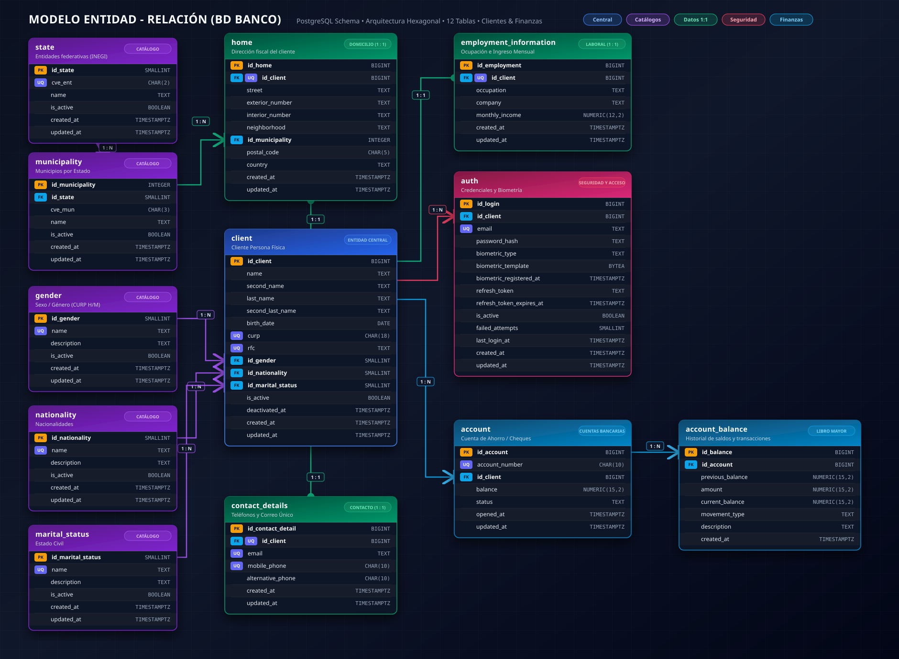
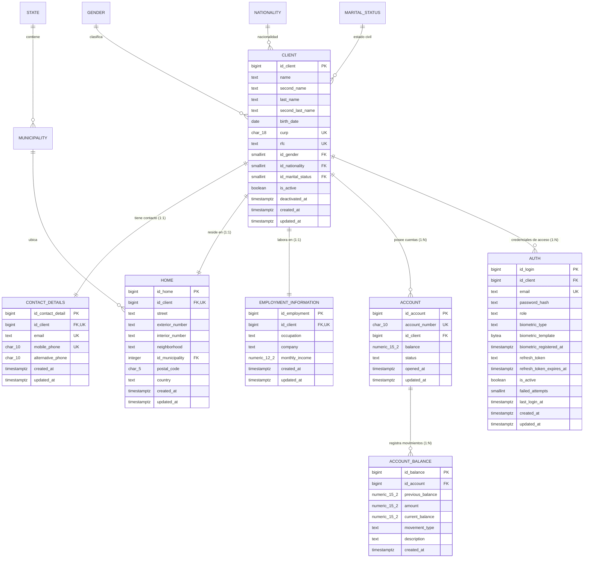
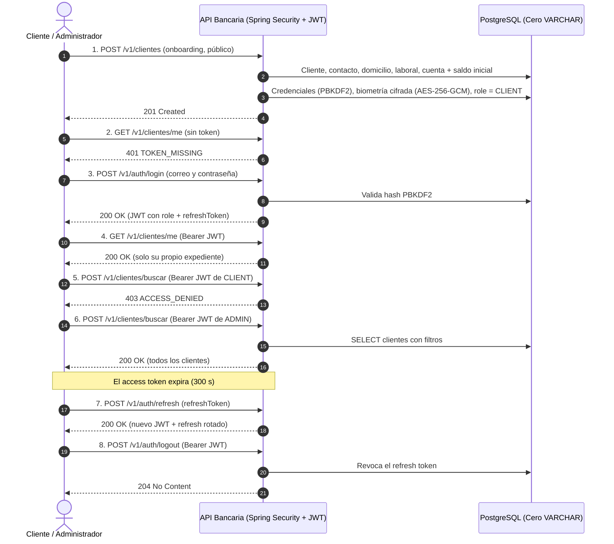

# 🏦 Sistema Bancario - Onboarding de Clientes Personas Físicas

Aplicación bancaria empresarial desarrollada en **Java 21** con **Spring Boot 3.5**, **Spring Data JPA**, **Flyway**, **PostgreSQL** y arquitectura limpia. Diseñada para registrar clientes personas físicas, validar de forma estricta sus datos de identidad, crear automáticamente una cuenta bancaria con saldo inicial asignado, auditar la tabla de saldos, proteger los datos biométricos con cifrado **AES-256-GCM** y controlar el acceso con **autenticación JWT stateless y roles (`CLIENT` / `ADMIN`)** mediante Spring Security.

---

## 📋 Índice
1. [Objetivo y Arquitectura](#-objetivo-y-arquitectura)
2. [Diseño de Base de Datos (Cero VARCHAR)](#-diseño-de-base-de-datos-cero-varchar)
3. [Diagrama Entidad-Relación (ER)](#-diagrama-entidad-relación-er)
4. [Seguridad y Cifrado de Información](#-seguridad-y-cifrado-de-información)
5. [Autenticación JWT y Roles](#-autenticación-jwt-y-roles)
6. [Flujo Integral Paso a Paso de la Aplicación](#-flujo-integral-paso-a-paso-de-la-aplicación)
7. [Catálogo Completo de Endpoints y Payloads JSON](#-catálogo-completo-de-endpoints-y-payloads-json)
8. [Matriz de Reglas de Negocio y Validaciones](#-matriz-de-reglas-de-negocio-y-validaciones)
9. [Instrucciones de Ejecución y Pruebas](#-instrucciones-de-ejecución-y-pruebas)
10. [Cobertura de Código y SonarQube (> 80%)](#-cobertura-de-código-y-sonarqube--80)

---

## 🎯 Objetivo y Arquitectura

El sistema automatiza el proceso de **Onboarding Bancario** para personas físicas, permitiendo a los ejecutivos de la institución financiera dar de alta clientes con validaciones oficiales (CURP, RFC, mayoría de edad, código postal de 5 dígitos, teléfonos a 10 dígitos y correos electrónicos normalizados).

### Componentes Principales:
* **Entidades de Dominio:** `Client`, `ContactDetail`, `Home`, `EmploymentInformation`, `Account`, `AccountBalance`, `Auth` y catálogos geográficos/demográficos.
* **Persistencia Robusta:** Migraciones Flyway versionadas (V1 a V20), repositorios JPA y soporte para base de datos PostgreSQL.
* **Servicios de Negocio Transaccionales:** Separación de responsabilidades con validaciones de negocio en servicio y restricciones `CHECK` en base de datos.
* **API REST & OpenAPI:** Controladores RESTful documentados con Swagger UI interactivo en `/swagger-ui.html`.

---

## 🗄️ Diseño de Base de Datos (Cero VARCHAR)

Cumpliendo con la directiva estricta de **NO USAR `VARCHAR`**, la base de datos aprovecha de forma óptima los tipos de datos nativos de PostgreSQL para maximizar el rendimiento y el uso eficiente de memoria:

| Tipo Usado | Campos de Aplicación | Justificación Técnica |
| :--- | :--- | :--- |
| `TEXT` | Nombres, apellidos, colonias, calles, ocupación, empresa, emails, hashes | En PostgreSQL, `TEXT` y `VARCHAR` tienen el mismo almacenamiento interno (`varlena`), pero `TEXT` evita la penalización de reescritura de tabla en migraciones y se complementa con restricciones `CHECK` con expresiones regulares (Regex). |
| `CHAR(18)` | CURP | Clave de longitud estrictamente fija de 18 caracteres alfanuméricos. |
| `CHAR(10)` | Teléfonos y Número de Cuenta | Longitud fija exacta (10 dígitos). Almacenamiento directo sin overhead. |
| `CHAR(5)` | Código Postal | 5 dígitos exactos según norma de Correos de México. |
| `NUMERIC(15,2)` | Saldos y montos bancarios | Precisión exacta para cálculo monetario sin pérdidas de redondeo de punto flotante. |
| `BYTEA` | Plantillas biométricas | Almacena el vector/minutiae biométrico cifrado con **AES-256-GCM**. |
| `SMALLINT` | Catálogos (Género, Estado Civil, Nacionalidad) y fallos | Ocupa solo 2 bytes por registro. |
| `BOOLEAN` | `is_active` | Indicador booleano compacto para control de baja lógica. |
| `DATE` | `birth_date` | 4 bytes, soporte natural de cálculos cronológicos. |
| `TIMESTAMPTZ` | Fechas de auditoría (`created_at`, `updated_at`, etc.) | Fechas con zona horaria universal (UTC). |

---

## 📊 Diagrama Entidad-Relación (ER)

<p align="center">
  
</p>

> 📥 **Formatos disponibles para descarga y visualización:**
> * **Vectorial SVG:** [`modelo_entidad_relacion.svg`](./modelo_entidad_relacion.svg)
> * **Imagen PNG en Alta Resolución:** [`modelo_entidad_relacion.png`](./modelo_entidad_relacion.png)

<details>
<summary><b>Ver código fuente Mermaid del diagrama</b></summary>


</details>

---

## 🔒 Seguridad y Cifrado de Información

La aplicación cuenta con capas de protección criptográfica para garantizar confidencialidad, autenticidad y resiliencia:

1. **Tabla de Login y Contraseñas Cifradas:**
   * Las contraseñas nunca se guardan en texto plano. Se procesan con `PBKDF2WithHmacSHA256`, empleando **10,000 iteraciones**, clave de **256 bits** y un **salt criptográfico aleatorio único de 16 bytes** generado mediante `SecureRandom`.
   * Formato guardado: `iteraciones:salt_base64:hash_base64`.
   * Bloqueo automático de acceso tras 5 intentos fallidos consecutivos (`failed_attempts >= 5`).
2. **Cifrado Simétrico de Datos Biométricos (AES-256-GCM):**
   * El servicio `AesEncryptionService` cifra los vectores y plantillas biométricas (huella dactilar o reconocimiento facial) con **AES-256 en modo Galois/Counter Mode (GCM)** (`AES/GCM/NoPadding`).
   * Cada cifrado produce un Vector de Inicialización (IV) único de 96 bits y genera una etiqueta de autenticación (Tag) de 128 bits para impedir alteraciones o manipulaciones no autorizadas.
   * La validación biométrica se compara en **tiempo constante** (`MessageDigest.isEqual`) para mitigar ataques de canal lateral (*timing attacks*).
3. **Tabla de Saldos y Auditoría Bancaria (`account_balance`):**
   * Cada apertura de cuenta, depósito o ajuste genera un registro inmutable en la tabla de saldos con el saldo anterior, el monto, el saldo resultante y la descripción.
4. **Protección de Tokens:**
   * Emisión de Access Tokens JWT firmados con clave HMAC-SHA256 y rotación automática de Refresh Tokens.

---

## 🔑 Autenticación JWT y Roles

La API es **stateless**: no existe un booleano ni una sesión global en el servidor. Cada petición protegida trae su propio `Authorization: Bearer <JWT>` y Spring Security (`SecurityConfig` + `JwtAuthenticationFilter`) decide el acceso.

### 1. El JWT
* Firmado con HMAC-SHA256 (`jwt.secret`, mínimo 32 bytes) y vigente `jwt.access-token-expiration-seconds` (300 s por defecto).
* Claims: `sub` (email), `idClient`, `idLogin`, `role` (`CLIENT` | `ADMIN`) y `authMethod` (`PASSWORD`, `BIOMETRIC_HUELLA`, `BIOMETRIC_FACIAL`, `REFRESH`).
* El **refresh token** (`POST /v1/auth/refresh`) rota en cada uso; `POST /v1/auth/logout` lo revoca.

### 2. Roles y permisos

| Recurso | Sin token | `CLIENT` | `ADMIN` |
| :--- | :---: | :---: | :---: |
| `GET /`, `/health`, Swagger, `GET /v1/catalogos/**` | ✅ | ✅ | ✅ |
| `POST /v1/auth/login`, `/login-biometrico`, `/refresh` | ✅ | ✅ | ✅ |
| `POST /v1/clientes` (onboarding) | ✅ | ✅ | ✅ |
| `GET /v1/clientes/me` (**solo el cliente del token**) | ❌ 401 | ✅ | ✅ |
| `GET /v1/cuentas/{n}/movimientos` (solo cuentas propias) | ❌ 401 | ✅ | ✅ (solo propias) |
| `POST /v1/pagos` (requiere token de **huella**) | ❌ 401 | ✅ | ✅ |
| `POST /v1/auth/biometria`, `POST /v1/auth/logout` | ❌ 401 | ✅ (solo propio) | ✅ |
| `POST /v1/clientes/buscar` (consulta de **todos** los clientes) | ❌ 401 | ❌ 403 | ✅ |
| `PATCH` / `DELETE /v1/clientes` | ❌ 401 | ❌ 403 | ✅ |
| `/v1/productos/**` (escritura), `/personas*`, `POST /v1/catalogos/sincronizar` | ❌ 401 | ❌ 403 | ✅ |
| `GET /v1/productos/**` | ❌ 401 | ✅ | ✅ |

> El antiguo flujo "iniciar sesión en el servidor y consultar todo" y el endpoint `/v1/auth/session-status` **fueron eliminados**. Un cliente solo consulta su información en `/v1/clientes/me`; la consulta global es exclusiva de `ADMIN`.

### 3. Cómo se asigna el rol
* Todo login nuevo nace como `CLIENT` (columna `auth.role`, migración `V20__add_role_to_auth.sql`).
* Para crear un administrador, define el correo de un login existente en `security.bootstrap-admin-email` (variable de entorno `SECURITY_BOOTSTRAP_ADMIN_EMAIL`); al arrancar se promueve a `ADMIN`. En desarrollo apunta al usuario demo.

### 4. Errores de seguridad (mismo formato JSON que el resto de la API)
| Situación | HTTP | `error.code` |
| :--- | :---: | :--- |
| Falta el header `Authorization: Bearer` | 401 | `TOKEN_MISSING` |
| JWT inválido, mal firmado o expirado | 401 | `TOKEN_EXPIRED_OR_INVALID` |
| Rol insuficiente | 403 | `ACCESS_DENIED` |
| Pago con token que no es de huella | 403 | `STRONG_AUTH_REQUIRED` |

---

## 🚀 Flujo Integral Paso a Paso de la Aplicación

A continuación se muestra el ciclo de vida completo de interacción con el sistema bancario:



---

## 📡 Catálogo Completo de Endpoints y Payloads JSON

### 1. Autenticación y Estado del Servidor

#### A. Inicio de Sesión Tradicional (Email y Contraseña)
* **Método:** `POST`
* **Ruta:** `/v1/auth/login`
* **Acceso:** Libre (Sin login previo)
* **Cuerpo de la Petición (`application/json`):**
```json
{
  "email": "roberto.hernandez@correo.com",
  "password": "Password123#_"
}
```
* **Respuesta Exitosa (200 OK):**
```json
{
  "token": "eyJhbGciOiJIUzI1NiJ9...",
  "refreshToken": "d7a8e2f14c2b480bb123456789abcdef",
  "tokenType": "Bearer",
  "expiresIn": 3600,
  "idClient": 1,
  "email": "roberto.hernandez@correo.com",
  "role": "CLIENT",
  "isActive": true,
  "hasBiometricRegistered": true,
  "biometricType": "HUELLA"
}
```

---

#### B. Inicio de Sesión Biométrico (Huella / Rostro)
* **Método:** `POST`
* **Ruta:** `/v1/auth/login-biometrico`
* **Acceso:** Libre (Sin login previo)
* **Cuerpo de la Petición (`application/json`):**
```json
{
  "email": "roberto.hernandez@correo.com",
  "biometricType": "HUELLA",
  "biometricData": "dmVjdG9yLWh1ZWxsYS1kaWdpdGFsLXBydWViYS0xMjM=",
  "deviceId": "Pixel-8-Pro-Fingerprint"
}
```
* **Respuesta Exitosa (200 OK):**
*(Devuelve tokens JWT con el rol del usuario; `authMethod = BIOMETRIC_HUELLA` habilita los pagos).*

---

#### C. Renovación de Token (Refresh)
* **Método:** `POST` · **Ruta:** `/v1/auth/refresh` · **Acceso:** Libre
* **Cuerpo:** `{ "refreshToken": "d7a8e2f14c2b480bb123456789abcdef" }`
* **Efecto:** devuelve un nuevo JWT (conserva el rol, `authMethod = REFRESH`) y rota el refresh token; el anterior deja de servir.

---

#### D. Cierre de Sesión (Logout)
* **Método:** `POST` · **Ruta:** `/v1/auth/logout` · **Acceso:** Requiere `Authorization: Bearer <JWT>`
* **Efecto:** revoca el Refresh Token del usuario dueño del JWT (ya no se envía el email por parámetro). El access token es stateless y expira por su vigencia.
* **Respuesta Exitosa (204 No Content)**

---

### 2. Onboarding y Clientes

#### A. Proceso Integral de Onboarding (Creación de Cuenta Automática y Biometría)
* **Método:** `POST`
* **Ruta:** `/v1/clientes/onboarding`
* **Acceso:** **Libre (público)**
* **Cuerpo de la Petición (`application/json`):**
```json
{
  "name": "Roberto",
  "secondName": "Carlos",
  "lastName": "Hernández",
  "secondLastName": "Gómez",
  "birthDate": "1995-08-15",
  "curp": "HEGR950815HDFRMN08",
  "rfc": "HEGR950815AB1",
  "idGender": 1,
  "idNationality": 1,
  "idMaritalStatus": 1,
  "email": "roberto.hernandez@correo.com",
  "mobilePhone": "5512345678",
  "alternativePhone": "5587654321",
  "street": "Avenida Insurgentes Sur",
  "exteriorNumber": "1602",
  "interiorNumber": "Piso 4 Depto 401",
  "neighborhood": "Crédito Constructor",
  "idMunicipality": 1,
  "postalCode": "03940",
  "country": "México",
  "occupation": "Ingeniero de Software",
  "company": "Tech Solutions México",
  "monthlyIncome": 45000.00,
  "initialBalance": 1000.00,
  "password": "Password123#_",
  "biometricType": "HUELLA",
  "biometricData": "dmVjdG9yLWh1ZWxsYS1kaWdpdGFsLXBydWViYS0xMjM="
}
```
* **Respuesta Exitosa (201 Created):**
```json
{
  "client": {
    "idClient": 1,
    "name": "Roberto",
    "secondName": "Carlos",
    "lastName": "Hernández",
    "secondLastName": "Gómez",
    "birthDate": "1995-08-15",
    "curp": "HEGR950815HDFRMN08",
    "rfc": "HEGR950815AB1",
    "idGender": 1,
    "idNationality": 1,
    "idMaritalStatus": 1,
    "isActive": true,
    "createdAt": "2026-09-26T18:25:00Z",
    "updatedAt": "2026-09-26T18:25:00Z"
  },
  "contactDetail": {
    "idContactDetail": 1,
    "idClient": 1,
    "email": "roberto.hernandez@correo.com",
    "mobilePhone": "5512345678",
    "alternativePhone": "5587654321"
  },
  "home": {
    "idHome": 1,
    "idClient": 1,
    "street": "Avenida Insurgentes Sur",
    "exteriorNumber": "1602",
    "interiorNumber": "Piso 4 Depto 401",
    "neighborhood": "Crédito Constructor",
    "idMunicipality": 1,
    "postalCode": "03940",
    "country": "México"
  },
  "employmentInformation": {
    "idEmployment": 1,
    "idClient": 1,
    "occupation": "Ingeniero de Software",
    "company": "Tech Solutions México",
    "monthlyIncome": 45000.00
  },
  "primaryAccount": {
    "idAccount": 1,
    "accountNumber": "9482015632",
    "idClient": 1,
    "balance": 1000.00,
    "status": "ACTIVA",
    "openedAt": "2026-09-26T18:25:00Z",
    "updatedAt": "2026-09-26T18:25:00Z"
  },
  "accounts": [
    {
      "idAccount": 1,
      "accountNumber": "9482015632",
      "idClient": 1,
      "balance": 1000.00,
      "status": "ACTIVA",
      "openedAt": "2026-09-26T18:25:00Z",
      "updatedAt": "2026-09-26T18:25:00Z"
    }
  ],
  "auth": {
    "idClient": 1,
    "email": "roberto.hernandez@correo.com",
    "isActive": true,
    "hasBiometricRegistered": true,
    "biometricType": "HUELLA"
  }
}
```

---

#### B. Consultas de Clientes

* **Consultar al cliente autenticado (cualquier rol):** `GET /v1/clientes/me` con `Authorization: Bearer <JWT>`. Admite `?includes=accounts,home,contact,employment`. Solo devuelve al cliente dueño del token.
* **Consultar a todos / con filtros (solo `ADMIN`):** `POST /v1/clientes/buscar` con cuerpo opcional:
```json
{
  "curp": "HEGR950815HDFRMN08",
  "rfc": "HEGR950815AB1",
  "idNationality": 1,
  "activo": true,
  "desde": "2026-01-01T00:00:00Z",
  "hasta": "2026-12-31T23:59:59Z",
  "sortBy": "createdAt",
  "sortDirection": "DESC"
}
```
  Un `CLIENT` recibe `403 ACCESS_DENIED`. **Ya no existe `GET /v1/clientes` para listar a todos los usuarios.**

---

#### C. Actualización de Información (PATCH, solo `ADMIN`)
* **Regla estricta:** **NO** se permite modificar `curp` ni `rfc`. Si se envían modificados, el sistema rechaza la petición con código HTTP `422 Unprocessable Entity`.
* **Reemplazo Completo (`PUT /v1/clientes/1`):**
```json
{
  "name": "Roberto",
  "secondName": "Carlos",
  "lastName": "Hernández",
  "secondLastName": "Gómez",
  "birthDate": "1995-08-15",
  "curp": "HEGR950815HDFRMN08",
  "rfc": "HEGR950815AB1",
  "idGender": 1,
  "idNationality": 1,
  "idMaritalStatus": 2
}
```
* **Actualización Parcial (`PATCH /v1/clientes/1`):**
```json
{
  "secondName": "Antonio",
  "idMaritalStatus": 2
}
```

---

#### D. Baja Lógica de Cliente (DELETE)
* **Método:** `DELETE`
* **Ruta:** `/v1/clientes/1`
* **Acceso:** Solo `ADMIN`
* **Efecto:**
  1. `client.is_active` pasa a `false` y se registra `deactivated_at = now()`.
  2. Todas sus cuentas bancarias asociadas pasan a estatus `'INACTIVA'`.
  3. Sus credenciales de acceso pasan a `is_active = false` y se revoca cualquier Refresh Token.
  4. La información física **permanece íntegra** en base de datos.
* **Respuesta Exitosa:** `204 No Content`.

---

### 3. Cuentas Bancarias y Tabla de Saldos

#### A. Consultar Cuenta por Número
* **Método:** `GET`
* **Ruta:** `/v1/cuentas/9482015632`
* **Respuesta (200 OK):**
```json
{
  "idAccount": 1,
  "accountNumber": "9482015632",
  "idClient": 1,
  "balance": 1000.00,
  "status": "ACTIVA",
  "openedAt": "2026-09-26T18:25:00Z",
  "updatedAt": "2026-09-26T18:25:00Z"
}
```

---

#### B. Consultar Saldo de la Cuenta
* **Método:** `GET`
* **Ruta:** `/v1/cuentas/9482015632/saldo`
* **Respuesta (200 OK):**
```json
{
  "accountNumber": "9482015632",
  "balance": 1000.00,
  "status": "ACTIVA"
}
```

---

#### C. Consultar Historial en la Tabla de Saldos (`account_balance` - Libro Mayor)
* **Método:** `GET`
* **Ruta:** `/v1/cuentas/9482015632/saldos` (o `/v1/cuentas/9482015632/movimientos`)
* **Respuesta (200 OK):**
```json
[
  {
    "idBalance": 1,
    "idAccount": 1,
    "accountNumber": "9482015632",
    "previousBalance": 0.00,
    "amount": 1000.00,
    "currentBalance": 1000.00,
    "movementType": "APERTURA",
    "description": "Apertura de cuenta con asignación de saldo inicial de bienvenida",
    "createdAt": "2026-09-26T18:25:00Z"
  }
]
```

---

#### D. Consultar Cuentas Activas
* **Método:** `GET`
* **Ruta:** `/v1/cuentas/activas`

---

## 🛡️ Matriz de Reglas de Negocio y Validaciones

| Campo / Regla | Restricción | Expresión Regular / Validación | Excepción / Código HTTP |
| :--- | :--- | :--- | :--- |
| **Nombre y Apellidos** | Obligatorios, solo letras y espacios, 2-50 caracteres | `^[A-Za-zÁÉÍÓÚÜÑáéíóúüñ ]{2,50}$` | `MethodArgumentNotValidException` (400) |
| **CURP** | 18 caracteres alfanuméricos, formato oficial RENAPO, Único | `^[A-Z]{4}[0-9]{6}[HM][A-Z]{2}[B-DF-HJ-NP-TV-Z]{3}[A-Z0-9][0-9]$` | `CurpDuplicatedException` (409) / 400 |
| **RFC** | 12 o 13 caracteres formato SAT, Único | `^[A-ZÑ&]{3,4}[0-9]{6}[A-Z0-9]{3}$` | `RfcDuplicatedException` (409) / 400 |
| **Mayoría de Edad** | >= 18 años cumplidos a la fecha actual, no fecha futura | `Period.between(birthDate, now).getYears() >= 18` | `BusinessValidationException` (422/400) |
| **Correo Electrónico** | Formato de email válido, máx 100 caracteres, Único | `^[A-Za-z0-9._%+-]+@[A-Za-z0-9.-]+\.[A-Za-z]{2,}$` | `EmailDuplicatedException` (409) / 400 |
| **Teléfono Móvil** | Exactamente 10 dígitos numéricos, Único | `^[0-9]{10}$` | `PhoneDuplicatedException` (409) / 400 |
| **Código Postal** | Exactamente 5 dígitos numéricos | `^[0-9]{5}$` | `MethodArgumentNotValidException` (400) |
| **Ingreso Mensual** | Debe ser mayor a 0 | `monthlyIncome > 0` | `BusinessValidationException` (422) |
| **Saldo Inicial** | No puede ser negativo | `initialBalance >= 0` | `BusinessValidationException` (422) |
| **Número de Cuenta** | Único, 10 dígitos autogenerados aleatoriamente | `^[0-9]{10}$` | Manejo automático en servicio |
| **Clientes Inactivos** | No pueden abrir ni tener cuentas activas | `client.isActive == true` | `ClientInactiveException` (400) |
| **Inmutabilidad** | Prohibido modificar CURP, RFC o Cuenta bancaria | Validación en `ClientServiceImpl` | `BusinessValidationException` (422) |
| **Autenticación y Roles** | JWT válido en `Authorization: Bearer`; consultas globales solo `ADMIN` | `SecurityConfig` / `JwtAuthenticationFilter` | `401 Unauthorized` / `403 Forbidden` |

---

## 💻 Instrucciones de Ejecución y Pruebas

### Requisitos Previos:
* **Java 21 (JDK 21)** instalado y configurado en el `PATH`.
* **PostgreSQL 14+** corriendo en `localhost:5432` con base de datos `banco` (o configurar credenciales en `application.properties`).

### 1. Ejecutar la Aplicación:
```powershell
# En la raíz del proyecto:
.\gradlew bootRun
```
* La aplicación iniciará en `http://localhost:8080`.
* Flyway aplicará automáticamente las migraciones desde `V1` hasta `V20__add_role_to_auth.sql`.

### 2. Acceso a Swagger UI:
Abre tu navegador en:
```
http://localhost:8080/swagger-ui.html
```
Podrás probar de forma gráfica todos los endpoints, ver esquemas y modelos.

### 3. Ejecutar la Suite de Pruebas Unitarias Automatizadas:
```powershell
.\gradlew test --no-daemon
```
* Las pruebas (unitarias y de integración con H2 en memoria) cubren autenticación JWT y roles, clientes, cuentas, pagos, catálogos, productos y el manejador global de errores.

### 4. Prueba Rápida con cURL (JWT y roles)

```bash
# 1. Registrar un cliente mediante Onboarding (PÚBLICO)
curl -X POST http://localhost:8080/v1/clientes \
  -H "Content-Type: application/json" \
  -d '{"name":"Roberto","secondName":"Carlos","lastName":"Hernandez","secondLastName":"Gomez","birthDate":"1995-08-15","curp":"HEGR950815HDFRMN08","rfc":"HEGR950815AB1","idGender":1,"idNationality":1,"idMaritalStatus":1,"email":"roberto@correo.com","mobilePhone":"5512345678","street":"Insurgentes Sur","exteriorNumber":"1602","neighborhood":"Centro","idMunicipality":1,"postalCode":"03940","country":"México","occupation":"Ingeniero","company":"Empresa SA","monthlyIncome":35000.00,"initialBalance":1000.00,"password":"Password123#_"}'

# 2. Sin token -> 401 TOKEN_MISSING
curl -i http://localhost:8080/v1/clientes/me

# 3. Login -> devuelve el JWT (guárdalo en TOKEN)
curl -X POST http://localhost:8080/v1/auth/login \
  -H "Content-Type: application/json" \
  -d '{"email":"roberto@correo.com","password":"Password123#_"}'

# 4. Consultar solo al cliente autenticado -> 200
curl -i http://localhost:8080/v1/clientes/me -H "Authorization: Bearer $TOKEN"

# 5. Consulta global con rol CLIENT -> 403 ACCESS_DENIED
curl -i -X POST http://localhost:8080/v1/clientes/buscar \
  -H "Authorization: Bearer $TOKEN" -H "Content-Type: application/json" -d '{}'

# 6. Con el usuario ADMIN (alejandro.hernandez@banco-demo.com en desarrollo) -> 200 con todos los clientes
curl -i -X POST http://localhost:8080/v1/clientes/buscar \
  -H "Authorization: Bearer $ADMIN_TOKEN" -H "Content-Type: application/json" -d '{}'
```

---
## 📈 Cobertura de Código y SonarQube (> 80%)

SonarQube toma la cobertura del reporte XML de JaCoCo (`build/reports/jacoco/test/jacocoTestReport.xml`). El Quality Gate por defecto ("Sonar way") exige **≥ 80 % de cobertura en código nuevo**.

### Estado actual (medido con JaCoCo tras los cambios)

| Métrica | Valor |
| :--- | :--- |
| Cobertura de líneas | **≈ 89.5 %** (1,514 de 1,691 líneas, excluyendo código generado/sin lógica) |
| Cobertura de ramas | ≈ 72.6 % |
| Pruebas | 195 (todas en verde) |

El umbral del **80 % de líneas** se verifica en el build con `jacocoTestCoverageVerification` (parte de `./gradlew check`).

### Paso 1. Exclusiones y umbral (ya aplicados en `build.gradle`)

`build.gradle` define `coverageExclusions` (MapStruct `*MapperImpl`, `model/**`, `entity/**`, `DemoApplication` y configuración sin lógica) y las aplica tanto a `jacocoTestReport` como a `sonar.coverage.exclusions`, de modo que JaCoCo y SonarQube miden lo mismo. También declara `sonar.coverage.jacoco.xmlReportPaths`.

### Paso 2. Pruebas añadidas

| Prueba | Qué cubre |
| :--- | :--- |
| `SecurityRolesIntegrationTest` | JWT con rol, `/me`, búsqueda global solo ADMIN, PATCH/DELETE, productos/personas, refresh, logout y biometría propia |
| `GlobalExceptionHandlerExtraTest` | Todos los `@ExceptionHandler` (incluido 404 de rutas inexistentes) |
| `BearerTokenValidatorTest` | Token ausente, mal formado, expirado, claims inválidos, huella vs. otros métodos |
| `ProductoServiceImplTest`, `ProductServiceRedisImplTest`, `TransformProductImplTest` | Catálogo de productos, caché Redis con fallback a BD y API, parseo XML |
| `GestoPagoTokenServiceImplTest` | Token estático, vigente, vencido, forzado y errores |
| `InegiClientImplTest` | Cliente INEGI contra un servidor HTTP local |
| `PersonasServiceImplTest`, `ProductoControllersTest`, `ClientSpecificationTest` | Personas, controladores delgados, jobs de catálogo y filtros JPA |

### Paso 3. Verificar localmente

```powershell
.\gradlew clean test jacocoTestReport --no-daemon
# Reporte HTML: build\reports\jacoco\test\html\index.html
```

### Paso 4. Enviar a SonarQube

El `Jenkinsfile` ya ejecuta `test jacocoTestReport` y luego `sonar`. Para correrlo a mano:

```powershell
.\gradlew sonar `
  -Dsonar.projectKey=Api_Gesto_Pago `
  -Dsonar.host.url=http://localhost:9000 `
  -Dsonar.token=<TOKEN_DE_SONARQUBE>
```

> No guardes el token en el repositorio; pásalo por variable de entorno o credencial de Jenkins.
